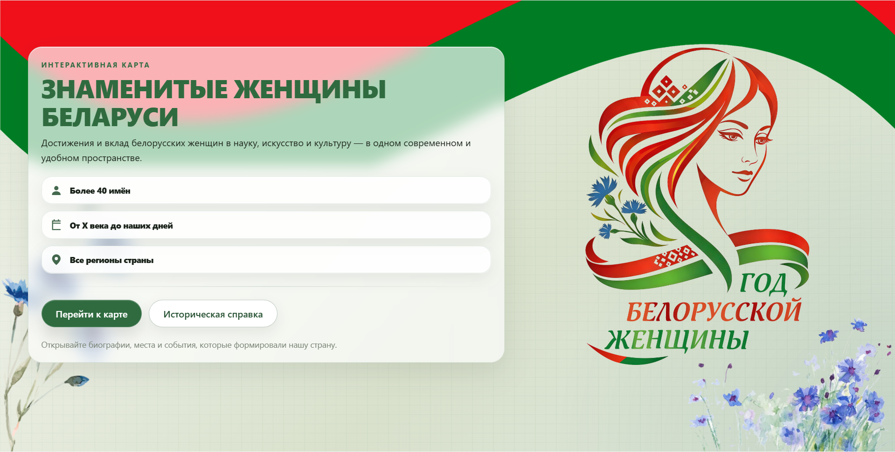
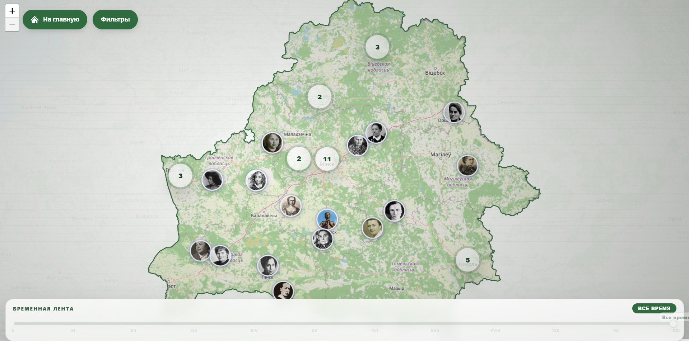
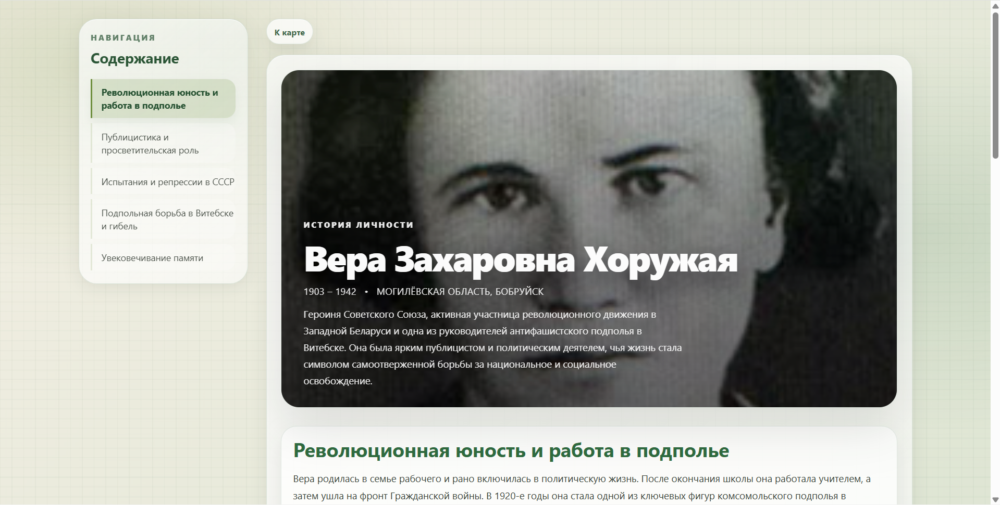

# Интерактивная карта "Знаменитые женщины Беларуси"

## Скриншоты
#### Главная страница

#### Страница "Карта"

#### Страница "Биография"

## Требования
- **Angular**: 21+
- **npm**: 11.12.1+
- **Node.js**: 22.14.0+

## Установка и запуск
1. **Клонирование репозитория**: `git clone https://github.com/ohresha/women-map.git`
2. **Установка зависимостей**: `npm install`
3. **Локальный запуск**: `ng serve`
> Вся информация о метках и биографиях находится в JSON-файле: `src/assets/data/women-data.json`

> Сайт доступен по ссылке: [Интерактивная карта "Знаменитые женщины Беларуси"](https://ohresha.github.io/women-map/) 